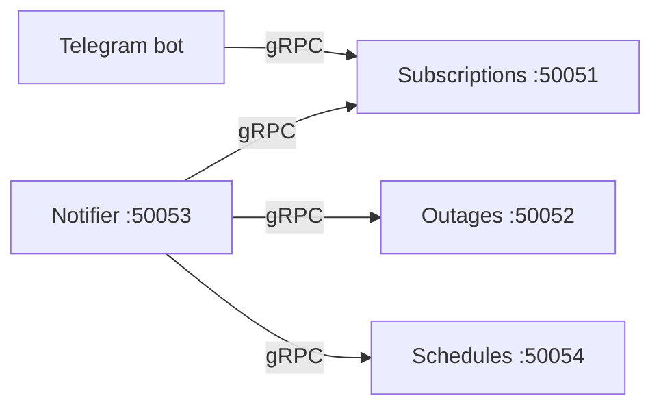

# Go + gRPC outage bot

A small Telegram bot for electricity outage notifications in Lviv, built as a
minimal Go microservices example.



Outages and Schedules call the LOE APIs over HTTP. The bot and notifier call the Telegram API
over HTTP.

Demonstrates unary and server-streaming RPCs, deadlines and cancellation, status
codes and error details, interceptors, health checks, reflection, and graceful shutdown.
Contracts live in `api/`, generated code in `gen/`, services in `internal/`, and
entry points in `cmd/`.

## Architecture

Each service separates its application from external systems using ports and adapters:

```text
internal/<service>/
  application/core/
    domain/            Domain models and rules
    api/               Application use cases
  ports/               Application and dependency interfaces
  adapters/            gRPC, HTTP, storage, or Telegram implementations
```

The gRPC adapters translate protobuf messages and status codes. Application code
uses domain values and interfaces; it has no gRPC or protobuf imports.
Entry points in `cmd/` construct the adapters and inject them into applications.
Shared configuration, gRPC server lifecycle, and Telegram HTTP code live in
`internal/platform/`.

For example, `SetSubscription` enters through the subscriptions gRPC adapter,
calls the application through `APIPort`, and persists through `DBPort` using the
JSON storage adapter. The notifier's gRPC handler and scheduler both invoke
the same application, which calls subscriptions and outages through client adapters.

## Run with Docker

Install Docker with Compose, then create the configuration:

```sh
cp .env.example .env
```

Set `TELEGRAM_BOT_TOKEN` in `.env` and start all five services:

```sh
docker compose --profile telegram up --build -d
```

Compose builds the Go binaries and loads `.env` automatically.
View logs with `docker compose --profile telegram logs -f`; stop the services with
`docker compose --profile telegram down`.

To explore just subscriptions and outages without a Telegram token:

```sh
docker compose up --build -d
```

The bot supports `/start`, `/subscription`, and `/stop`.
See [.env.example](.env.example) for configuration.

## Try gRPC

Install [grpcurl](https://github.com/fullstorydev/grpcurl) (`brew install grpcurl`
on macOS). Reflection lets it discover each server's contracts:

```sh
grpcurl -plaintext localhost:50051 list
grpcurl -plaintext -d '{}' localhost:50051 grpc.health.v1.Health/Check

grpcurl -plaintext -d '{"query":"Наукова"}' \
  localhost:50051 subscriptions.v1.SubscriptionService/SearchStreets

grpcurl -plaintext -d '{"chatId":"42","streetId":12446,"building":"2-Б"}' \
  localhost:50051 subscriptions.v1.SubscriptionService/SetSubscription

grpcurl -plaintext -d '{}' \
  localhost:50051 subscriptions.v1.SubscriptionService/ListSubscriptions

grpcurl -plaintext -max-time 25 -d '{}' \
  localhost:50052 outages.v1.OutageService/FetchSnapshot

grpcurl -plaintext -max-time 25 -d '{}' \
  localhost:50054 schedules.v1.ScheduleService/FetchSchedules

grpcurl -plaintext -max-time 1800 -d '{}' \
  localhost:50053 notifications.v1.NotificationService/RunOnce
```

`42` is an example chat ID. `RunOnce` requires the Telegram profile and sends
real Telegram messages to matching subscribers. The notifier also runs at startup
and every minute; set `NOTIFY_INTERVAL=0` for manual runs only.

## Optional local development

To edit and test the Go code outside Docker, install Go **1.27+**.

```sh
make build
make test
```

Four gRPC integration tests cover subscription RPCs, notification coordination,
schedule broadcasts, and cancellation. They need no external services or Telegram token.

Generated sources are committed. To edit contracts, install `protoc`
(`brew install protobuf` on macOS), then run:

```sh
make generate
```

This installs pinned Go generators into `.cache/bin/` and regenerates `gen/`.

## Behavior

- Subscriptions persist as JSON in the Compose `users` volume. Only the
  subscriptions service owns these files.
- Building text is stored as entered and matched exactly against the feed.
- If any current outage for an address matches its last delivered notification,
  the address is skipped. Otherwise the first matching outage is sent.
- Besides outage matching, the notifier polls Schedules every `SCHEDULE_INTERVAL`
  (default 15m, `0` disables) and broadcasts changes to today's or tomorrow's
  schedule to every subscriber. It remembers the last schedules in memory, so the
  first poll after a start sends nothing. Subscribers who blocked the bot are removed.
- Bot conversations reset on restart. A crash between sending and recording a
  notification can cause a duplicate.
- Each process runs as a single instance. gRPC uses plaintext for local development.
